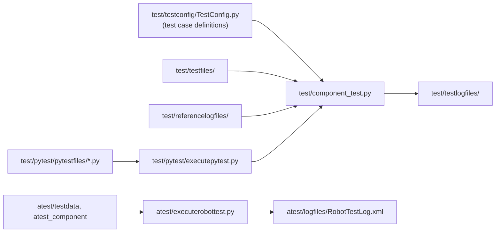

# Build, test and document

## Development setup

```bash
git clone https://github.com/test-fullautomation/robotframework-testsuitesmanagement.git
cd robotframework-testsuitesmanagement
python -m pip install -e ".[dev]"
```

The `dev` extra installs `pytest` and `pytest-cov`. Python 3.11 or newer is required.

!!! tip "Working on TSM and JsonPreprocessor together"
    Instead of installing, both repositories can be used from source:
    `PYTHONPATH=<path>/robotframework-testsuitesmanagement;<path>/python-jsonpreprocessor` (Windows separator `;`)
    and `python -m robot ...`.

## Helper scripts

| Script / command | Purpose |
|---|---|
| `cleanup_installation.py` | removes previous installations and build artifacts |
| `genpackagedoc.py` | generates the PDF documentation from `packagedoc/` (GenPackageDoc) |
| `python -m pip install .` | installs the package from the sources |
| `python -m build .` | builds sdist and wheel |
| `robfwaio_version` | console script; prints the version information of the installation |

The version is defined in `RobotFramework_TestsuitesManagement/version.py` (`VERSION`, `VERSION_DATE`) and read by
`pyproject.toml`.

## Tests



### Component test

The component test is the main regression test. Every test case (`TSM_xxxx`) is configured in
`test/testconfig/TestConfig.py` and executes a robot file with a dedicated configuration.

```bash
cd test
python component_test.py                         # all test cases
python component_test.py --testid="TSM_0001"     # a single test case
```

A test case is `PASSED` if

1. the return value of Robot Framework is as expected (`EXPECTEDRETURN`),
2. the log file contains no forbidden patterns (log file pre check), and
3. the log file matches the reference log file in `test/referencelogfiles/` (with ignore patterns from `test/testconfig/`).

The overview of all test cases is available in `test/TSM_TestUsecases.html` (also `.csv`, `.rst`, `.txt`).
Further options (PRESTEP/POSTSTEP, ignore patterns, web application support) are described in `test/readme.rst`.

!!! warning "Log files folder"
    `test/testlogfiles` is deleted at the beginning of every component test run.

### Component test under pytest

`test/pytest/pytestfiles/` contains one pytest file per section (`test_01_VARIANT_HANDLING_GOODCASE.py` ...).

```bash
cd test/pytest
python executepytest.py            # log: logfiles/PyTestLog.xml
```

### Acceptance test

```bash
cd atest
python executerobottest.py         # log: logfiles/RobotTestLog.xml
python executerobottest.py --robotcommandline="<robot options>"
```

### Adding a test case

1. Add the robot file and the configuration files to `test/testfiles/`.
2. Add a test case definition with a new `TESTID` to `test/testconfig/TestConfig.py`
   (`SECTION` = tested feature, `SUBSECTION` = `GOODCASE` or `BADCASE`).
3. Run the component test for the new `TESTID`, review the log file and store it as reference log file.
4. Run the complete test.

## Documentation

This documentation is built with **ProperDocs** (an MkDocs fork) and the Material theme.
The configuration is `properdocs.yml`, the sources are in `doc/`.

```bash
pip install properdocs mkdocs-material pymdown-extensions
properdocs serve      # live preview on http://127.0.0.1:8000
properdocs build      # static site
```

| Need | Markdown |
|---|---|
| Diagram | ` ```mermaid ` code block |
| Hint / warning | `!!! tip`, `!!! warning`, `??? question` (collapsible) |
| Tabs | `=== "Tab title"` |
| Highlighted lines | ` ```json hl_lines="3" ` |

!!! note
    The chapter [The JSONP format](../jsonp-format/index.md) is based on the documentation of the JsonPreprocessor.
    Changes of the JSONP syntax should be applied in both repositories.

!!! note
    The PDF documentation (`RobotFramework_TestsuitesManagement/RobotFramework_TestsuitesManagement.pdf`) is still
    generated from `packagedoc/` with `genpackagedoc.py`. Content changes should be applied to both until the PDF is retired.

## Contribution checklist

1. Keyword interface unchanged (or change documented in [Keyword reference](../reference/keywords.md) and
   [History](../appendix/history.md)).
2. Component test, pytest and acceptance test pass.
3. New behavior covered by a test case (good case and bad case).
4. User documentation in `doc/user-guide/` updated.
5. Version and date updated in `RobotFramework_TestsuitesManagement/version.py`.
