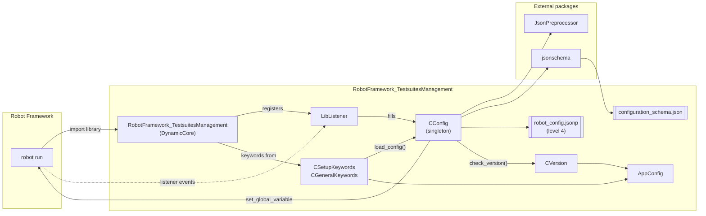

# For Developers

This chapter is meant for everybody who wants to understand, maintain or extend the RobotFramework_TestsuitesManagement
(TSM). It gives an overview of the code base and explains how the parts work together.

| Page | Content |
|---|---|
| [Startup sequence](startup-sequence.md) | what happens from `robot` start until the first test case runs |
| [Modules](modules.md) | the single source files and their responsibilities |
| [Build, test and document](build-and-test.md) | development setup, tests, documentation |

## Repository layout

```text
robotframework-testsuitesmanagement/
├── RobotFramework_TestsuitesManagement/   # the Python package (= Robot Framework library)
│   ├── __init__.py                        # library class, CConfigLevel, CTestsuitesCfg
│   ├── version.py                         # VERSION, VERSION_DATE
│   ├── Config/
│   │   ├── config.py                      # CConfig: loading, validation, global variables
│   │   ├── configuration_schema.json      # JSON schema of configuration files
│   │   └── robot_config.jsonp             # level 4 default configuration
│   ├── Keywords/
│   │   ├── key_words.py                   # CSetupKeywords, CGeneralKeywords
│   │   └── on_failure_handle.py           # COnFailureHandle
│   └── Utils/
│       ├── lib_listener.py                # LibListener (Robot Framework listener API v3)
│       ├── version.py                     # CVersion, StatusMessages, enVersionCheckResult
│       ├── app_config.py                  # AppConfig (stand-alone vs. RobotFramework AIO)
│       ├── app_logger.py                  # isolated Python logger for CVersion
│       ├── new_struct.py                  # CStruct helper
│       └── Events/                        # scope_start / scope_end events
├── atest/                                 # acceptance test (robot files)
├── test/                                  # component test (TSM_xxxx test cases) and pytest wrapper
├── doc/                                   # this documentation (ProperDocs)
├── packagedoc/                            # sources of the PDF documentation (GenPackageDoc)
├── config/                                # repository configuration used by the helper scripts
├── properdocs.yml                         # configuration of this documentation
└── pyproject.toml                         # package metadata and build configuration
```

## Architecture at a glance

The TSM consists of two cooperating parts:

* a **listener** that collects information from the command line and the suite structure *before* anything is executed,
* **keywords** (mainly `Testsuite Setup`) that load the configuration and make it available as Robot Framework variables.

Both share one state object: the singleton `CConfig`, accessible via `TM.CTestsuitesCfg.config_obj`.



## Key design decisions

| Decision | Reason |
|---|---|
| Library scope `GLOBAL` | one library instance for the complete run; the configuration is loaded once per suite but the counters are global |
| `CConfig` is a singleton | listener and keywords work on the same state without passing objects around |
| Listener API v3 | the listener must see the command line variables and the suite tree **before** the first keyword runs |
| Errors are collected, not raised immediately | `CConfig.loaded_cfg_log` gathers all errors and hints; `Testsuite Setup` logs them together and aborts with one final message |
| Command line variables are remembered at the first suite | `buitin_variables` prevents that configuration values overwrite them (see [Priority](../user-guide/priority.md)) |
| `CVersion` uses a pure Python logger | the version check must also work outside of Robot Framework (see [Python API](../reference/python-api.md)) |
| JSONP parsing is delegated | all syntax features come from the [JsonPreprocessor](../jsonp-format/index.md) |

## Where to start reading

1. `RobotFramework_TestsuitesManagement/__init__.py` - the library class and how listener and keywords are wired.
2. `Utils/lib_listener.py` - `_start_suite` shows which information is collected from the command line.
3. `Keywords/key_words.py` - `testsuite_setup` is the main entry point for users.
4. `Config/config.py` - `load_config` contains the complete loading logic.
