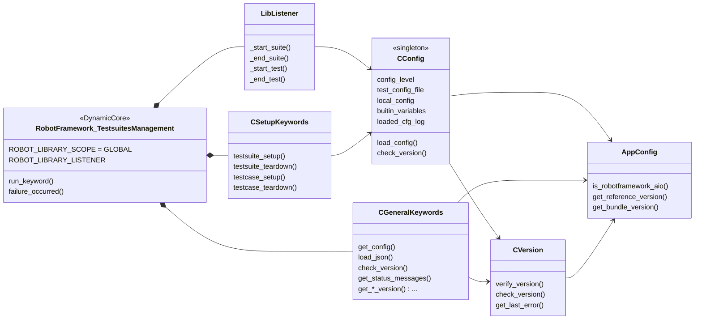
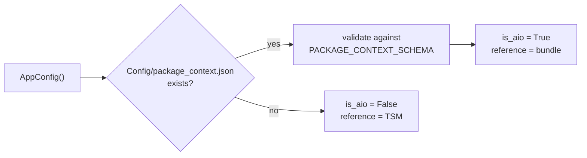

# Modules

This page describes the single source files of the package `RobotFramework_TestsuitesManagement`.

## `__init__.py`

| Element | Description |
|---|---|
| `RobotFramework_TestsuitesManagement` | the library class; based on `robotlibcore.DynamicCore` and collects the keywords of `CSetupKeywords` and `CGeneralKeywords`; registers `LibListener` as library listener |
| `run_keyword()` | wrapper around every keyword call; calls `failure_occurred()` in case of an exception (executes an optionally configured *run on failure* keyword) |
| `CConfigLevel` | enumeration `LEVEL_1` ... `LEVEL_4` |
| `CTestsuitesCfg` | holds the shared `config_obj` (the `CConfig` instance) |

## `version.py`

Contains `VERSION` and `VERSION_DATE` of the package. `pyproject.toml` reads the version from here.

## `ide_variables.py`

Variable file for the static code analysis in the IDE, see [IDE support](../user-guide/ide-support.md).

| Element | Description |
|---|---|
| `get_variables()` | Robot Framework variable file interface; returns the result of `load_config()` only if `is_static_analysis()` is `True`, otherwise `{}`; additionally returns every dictionary key as variable in dotdict notation (`CONFIG.Project`) for the code completion |
| `load_config()` | loads a variant configuration file (level 2) or a parameter configuration file (level 1) with the JsonPreprocessor and returns `CONFIG` and the parameters of `params` → `global` as `DotDict` |
| `is_static_analysis()` | `True` if the module `robotcode.robot.diagnostics.library_doc` is loaded - this is only the case in the code analysis of RobotCode (language server, `robotcode analyze`), not in test executions |

## `Config/config.py` - `CConfig`

The heart of the package. A singleton that holds the state of the whole test run and contains the loading logic.

| Member | Description |
|---|---|
| `load_config()` | determines the level, loads and merges the files, validates and sets the global variables (see [Startup sequence](startup-sequence.md#phase-3-cconfigload_config)) |
| `__load_config_file_level2()` | reads the variant configuration file, searches the file (also with the `.../` prefix) and selects the variant |
| `__merge_dicts()` | recursive merge of the local configuration into the main configuration |
| `__update_global_variable()`, `__set_global_variable()` | naming convention check and creation of Robot Framework variables |
| `check_version()` | version check against `Maximum_version` / `Minimum_version` with Robot Framework specific messages |
| `__get_machine_name()`, `__get_user_name()` | metadata (`machine`, `tester`) |
| `loaded_cfg_log` | collected errors, hints and the final abort message |
| `buitin_variables` | names of variables that existed before the configuration was loaded (command line wins) |

Data files in the same folder:

| File | Description |
|---|---|
| `configuration_schema.json` | JSON schema that every configuration file must fulfill |
| `robot_config.jsonp` | default configuration of level 4 |
| `package_context.json` | only available within RobotFramework AIO; information about the bundle |

## `Keywords/key_words.py`

| Class | Keywords |
|---|---|
| `CSetupKeywords` | `Testsuite Setup`, `Testsuite Teardown`, `Testcase Setup`, `Testcase Teardown` |
| `CGeneralKeywords` | `Get Config`, `Load Json`, `Check Version`, `Get Status Messages`, information keywords (`Is Robotframework AIO`, `Get ... Version` ...) |

All keywords are described in the [Keyword reference](../reference/keywords.md).

## `Keywords/on_failure_handle.py`

`COnFailureHandle` contains helper code for the *run on failure* handling of the library.

## `Utils/lib_listener.py` - `LibListener`

Listener (API version 3) that is registered by the library itself. It collects command line information at the first
suite, maintains the counters `${SUITECOUNT}` and `${TESTCOUNT}`, changes the working directory to the suite folder and
dispatches `scope_start` / `scope_end` events. Details: [Startup sequence](startup-sequence.md#phase-1-listener-liblistener_start_suite).

## `Utils/version.py`

| Element | Description |
|---|---|
| `enVersionCheckResult` | result tokens of the version check |
| `StatusMessages` | dictionary-like container for message texts with placeholders |
| `CVersion` | `verify_version()` (low level, returns a token), `check_version()` (high level, logs and raises), `tuple_version()` and validation helpers |

Public usage: [Python API](../reference/python-api.md).

## `Utils/app_config.py` - `AppConfig`

Decides whether the TSM runs stand-alone or as part of RobotFramework AIO:

It also provides the console script `robfwaio_version` (`print_bundle_version()`).

## `Utils/app_logger.py`

`setup_app_logger()` creates an isolated Python logger (`[TestsuitesManagement] ...` on stdout). It is used by
`CVersion`, because the Robot Framework logger must not be used outside of a keyword execution.

## `Utils/Events/`

A minimal event system: `on(event_name, scope, action)` registers an action, `dispatch(event_name, scope)` triggers
all actions registered for this scope. Available events are `scope_start` and `scope_end` (`ScopeStart`, `ScopeEnd`);
the scope `current` is resolved to the current suite or test name.

## `Utils/new_struct.py`

`CStruct` creates attributes from keyword arguments (like a C struct).

## Dependencies

| Package | Used for |
|---|---|
| `robotframework` | `BuiltIn`, logger, `DotDict`, version information |
| `robotframework-pythonlibcore` | `DynamicCore` (library with keywords from several classes) |
| `JsonPreprocessor` | loading of JSONP files |
| `jsonschema` | validation of configuration files and package context |
| `regex` | naming convention check with Unicode classes (`\p{L}`) |
| `PythonExtensionsCollection` | `CString` (path normalization) |
