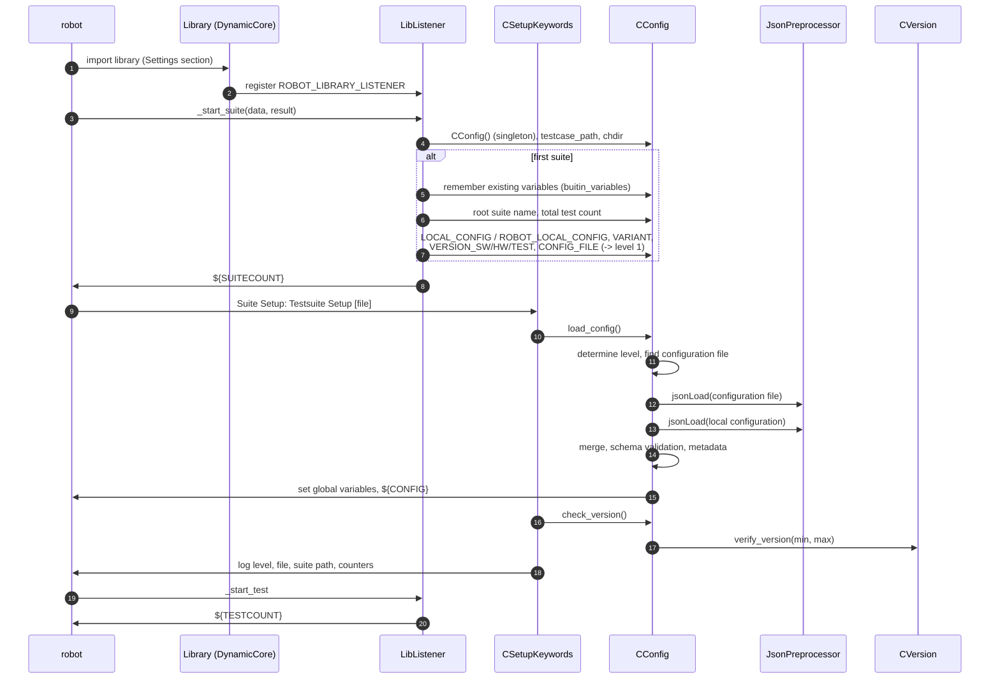
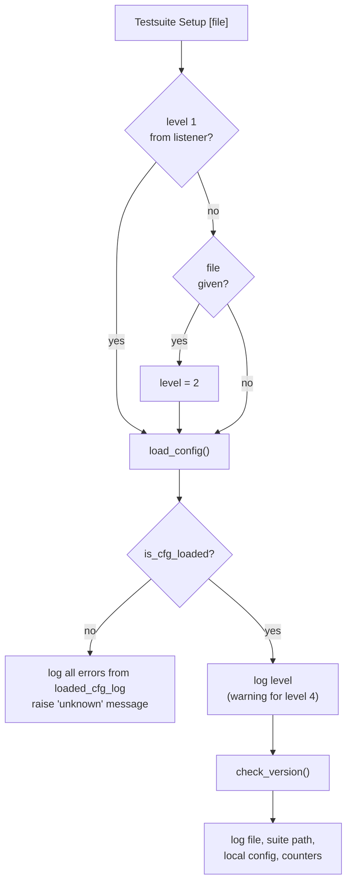
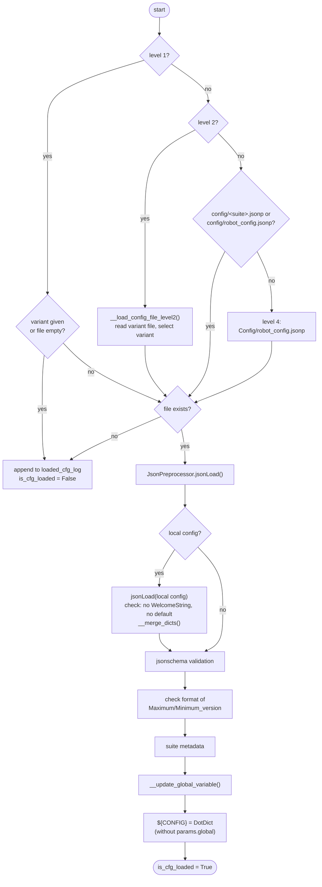

# Startup sequence

This page describes what happens from the start of `robot` until the first test case is executed.

## Overview

## Phase 1: Listener (`LibListener._start_suite`)

Executed for **every** suite, before the suite setup:

* `CConfig()` returns the singleton instance.
* `testcase_path` is set to the folder of the suite and the **current working directory is changed** to it.
  That's why relative paths in `Testsuite Setup` and in configuration files are relative to the suite file.

Additionally, executed only for the **first** suite (`suite_count == 0`):

| Collected information | Source |
|---|---|
| `buitin_variables` | names of all variables that exist at this point (built-in and command line) |
| `root_suite_name`, `total_testcases` | root of the suite tree |
| `local_config` | `--variable local_config:...` or environment variable `ROBOT_LOCAL_CONFIG` |
| `config_name` | `--variable variant:...` |
| `meta_data.version_sw/hw/test` | `--variable version_sw:...` etc. |
| `test_config_file`, `config_level = LEVEL_1` | `--variable config_file:...` |

At the end `suite_count` is incremented and `${SUITECOUNT}` is set.

`_end_suite` resets the level to `LEVEL_4` (and the configuration file, unless level 1 is active).
So every suite determines its level again in its own `Testsuite Setup`.

## Phase 2: `Testsuite Setup`

## Phase 3: `CConfig.load_config`

### Error handling

`CConfig.loaded_cfg_log` is a dictionary with three entries:

| Key | Content |
|---|---|
| `error` | list of error messages (logged as errors) |
| `info` | list of hints (also logged as errors) |
| `unknown` | final message; used as exception text that aborts the suite |

This allows to report all relevant information at once instead of stopping at the first problem.

### Setting global variables

`__update_global_variable` walks through `params` → `global`:

1. Reserved names (`Settings`, `Variables`, `Keywords`, `Comments`, `Documentation`, `Metadata`) cause an error.
2. Names contained in `buitin_variables` are **skipped** - this is how command line values win.
3. `__set_global_variable` checks the name against `^\p{L}[\p{L}\p{Nd}_]*$`, converts dictionaries (also inside
   lists) to `DotDict` and calls `BuiltIn().set_global_variable()`.

!!! note "Exact name comparison"
    `buitin_variables` contains the names as they were found at the first suite. The comparison is exact, therefore
    a command line variable only wins if it is spelled exactly like the configuration parameter
    (see [Priority](../user-guide/priority.md)).

## Phase 4: Version check

`CConfig.check_version()` uses the **low level** method `CVersion.verify_version()` and formulates own messages
that fit to Robot Framework tests. The reference version is taken from `AppConfig`:

| Installation | Reference version |
|---|---|
| part of RobotFramework AIO (`Config/package_context.json` exists) | bundle version |
| stand-alone | version of the TSM itself |
