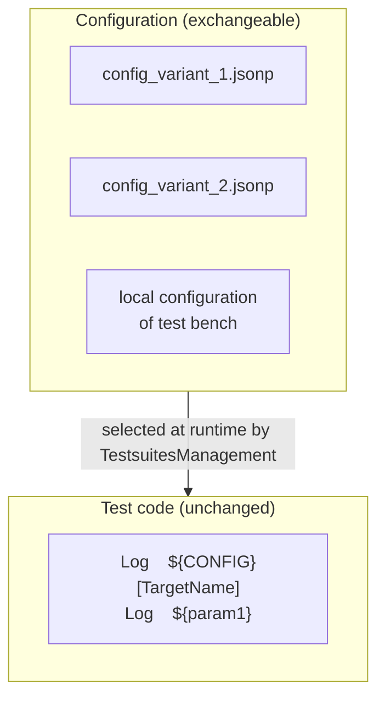

# Introduction

## The problem

Usually all test cases of a test suite run under the same conditions - but these conditions may differ:

- The same test is used to test **several variants** of a system under test. Every variant requires individual values
  for certain configuration parameters.
- Tests are executed on **several test benches** with different hardware. Also the test benches may require individual values.

**Therefore the same tests have to run under different conditions!**

Robot Framework offers several places to define parameters - robot files, resource files, variable files. But these
parameters are fixed. Switching between variants or test benches would require changes in the test code.

## The solution

The TestsuitesManagement introduces a separate place for variant and test bench specific values: **configuration files
in JSONP format**. Depending on outer circumstances (*which variant?*, *which test bench?*) the TestsuitesManagement
selects the matching configuration and makes all values globally available during test execution.

## Two kinds of configuration files

| File | Content | Number per project |
|---|---|---|
| **Parameter configuration file** | all parameter definitions (mandatory and user defined parameters) | one or more |
| **Variant configuration file** | mapping between a variant name and a parameter configuration file | exactly one |

The variant name can be used in command line to select a parameter configuration file - which is easier than always
mentioning the path and the name of a configuration file.

## The JSONP format

All configuration files are implemented in JSON format, extended by useful features like comments, imports and
references between parameters. Because of these deviations from standard JSON, the files have the extension
`.jsonp` instead of `.json`. Details: [The JSONP format](../jsonp-format/index.md).

## Next steps

1. [Install](installation.md) the TestsuitesManagement.
2. Create your first configuration with the [Quick start](quick-start.md).
3. Read the [User guide](../user-guide/meaning.md) to plan the configuration of your project.
