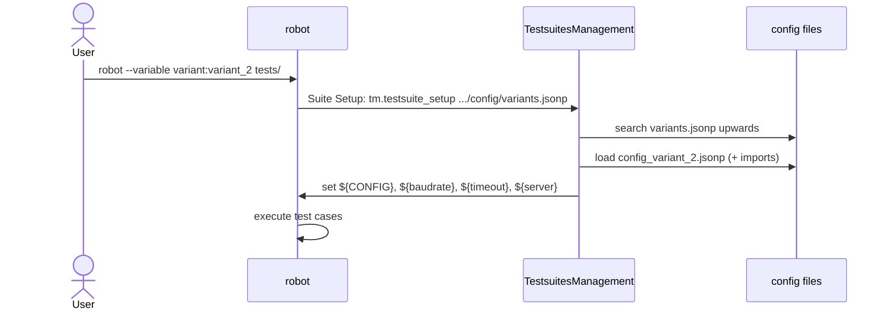

# Quick start

In this example we create a small project with two variants. It covers the recommended way of working
(configuration level 2) and takes only a few minutes.

## 1. Project structure

```text
my_project/
├── config/
│   ├── variants.jsonp            # variant configuration file
│   ├── config_common.jsonp       # common parameters (imported)
│   ├── config_variant_1.jsonp    # parameter configuration file of variant_1
│   └── config_variant_2.jsonp    # parameter configuration file of variant_2
└── tests/
    └── example.robot
```

## 2. The variant configuration file

`config/variants.jsonp` maps variant names to parameter configuration files. The paths are relative to this file.

```json
{
  "default"   : { "name" : "config_variant_1.jsonp", "path" : "./" },
  "variant_1" : { "name" : "config_variant_1.jsonp", "path" : "./" },
  "variant_2" : { "name" : "config_variant_2.jsonp", "path" : "./" }
}
```

## 3. The parameter configuration files

`config/config_variant_1.jsonp`:

```json
{
  "WelcomeString"   : "Hello... Robot Framework is running now!",
  "Maximum_version" : null,
  "Minimum_version" : null,
  "Project"         : "My project",
  "TargetName"      : "Device_variant_1",
  "params" : {
     "global" : {
        "[import]"  : "./config_common.jsonp",   // common parameters
        "baudrate"  : 9600                       // variant specific parameter
     }
  }
}
```

`config/config_variant_2.jsonp` looks the same, but with `"TargetName" : "Device_variant_2"` and `"baudrate" : 115200`.

`config/config_common.jsonp` (a fragment - only user defined parameters):

```json
{
  "timeout" : 10,
  "server"  : { "host" : "localhost", "port" : 8080 }
}
```

## 4. The robot file

`tests/example.robot`:

```robotframework
*** Settings ***
Library        RobotFramework_TestsuitesManagement    AS    tm
Suite Setup    tm.testsuite_setup    .../config/variants.jsonp

*** Test Cases ***
Show configuration
    Log    Target: ${CONFIG}[TargetName]    console=yes
    Log    Baudrate: ${baudrate}    console=yes
    Log    Server: ${server.host}:${server.port}    console=yes
```

The three dots `.../` tell the TestsuitesManagement to search the `config` folder upwards from the robot file location.

## 5. Run the tests

=== "Default variant"

    ```bash
    robot tests/example.robot
    ```

=== "variant_2"

    ```bash
    robot --variable variant:variant_2 tests/example.robot
    ```

The log file shows which configuration was selected and why:

```text
INFO - Running with configuration level 2 (variant name in command line)
INFO - Loaded configuration file '.../my_project/config/config_variant_2.jsonp'
```



## What's next?

- Understand the [configuration levels](../user-guide/configuration-levels.md).
- Add test bench specific values with a [local configuration](../user-guide/local-configuration.md).
- Learn all features of [the JSONP format](../jsonp-format/index.md).
