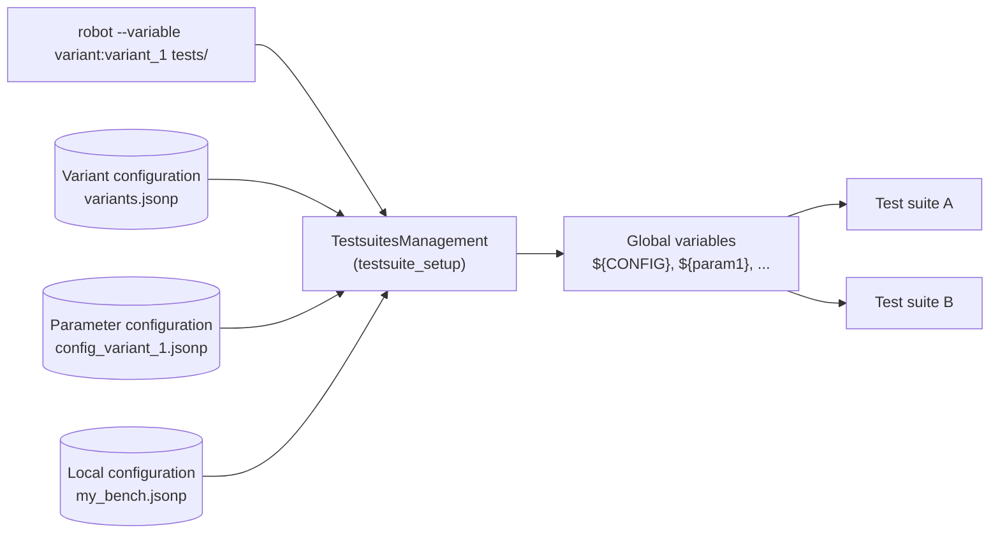

# RobotFramework_TestsuitesManagement

**Run the same Robot Framework tests for different variants and on different test benches - without changing a single line of test code.**

The **RobotFramework_TestsuitesManagement** (short: *TestsuitesManagement* or *TSM*) is a Robot Framework library that
loads variant and test bench specific parameters from JSON configuration files and makes them available as
global Robot Framework variables during test execution.

## Features at a glance

| Feature | Benefit |
|---|---|
| Variant handling | Select a set of parameter values by a simple name in command line |
| Four configuration levels | Clear and traceable rules which configuration file is used |
| Local configuration | Test bench specific values without touching the shared configuration |
| JSONP format | JSON with comments, imports, references between parameters and much more |
| Version control | Make sure that tests run with the expected version of the installation |
| Logging | The log file contains which configuration was selected and why |

## Where to start?

- **New to the TestsuitesManagement?**

    Read the [Introduction](getting-started/introduction.md) and follow the [Quick start](getting-started/quick-start.md).

- **Want to understand the concepts?**

    Start with the [User guide](user-guide/meaning.md) - it explains step by step how variants, levels and priorities work.

- **Looking for the configuration syntax?**

    The chapter [The JSONP format](jsonp-format/index.md) and the [Cheat sheet](jsonp-format/cheat-sheet.md) explain all features.

- **Searching a certain keyword?**

    See the [Keyword reference](reference/keywords.md).

## Part of RobotFramework AIO

The TestsuitesManagement is part of the **RobotFramework AIO** bundle
([robotframework-aio.org](https://robotframework-aio.org/)), but can also be installed stand-alone from PyPI.
For self-study a [tutorial](https://htmlpreview.github.io/?https://github.com/test-fullautomation/robotframework-tutorial/blob/develop/900_building_testsuites/building_testsuites.html)
with many examples is available.
