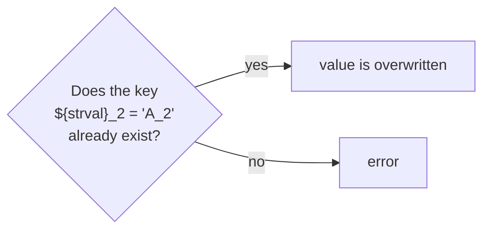

# Dynamic key names

In section [Overwriting parameters](overwriting-parameters.md#composite-strings) we defined the value of string
parameters dynamically:

```json
"str_val"   : "ABC",
"newparam1" : "prefix_${str_val}_suffix",
```

The same is possible at the **left-hand side** of the colon. In this case the name of the key that shall be
overwritten is created dynamically.

## Example

```json
"strval"  : "A",
"dictval" : {"A_2" : 1},
${dictval}['${strval}_2'] : 2
```

The second line defines a dictionary with the key `A_2`. The third line overwrites the initial value of this key.
The name of this key is composed with the help of the parameter `strval`.

**Outcome:**

```python
{'dictval': {'A_2': 2}, 'strval': 'A'}
```

The same in dotdict notation:

```json
"strval"  : "A",
"dictval" : {"A_2" : 1},
${dictval.${strval}_2} : 3
```

## Precondition: the key must exist

!!! warning
    The precondition for using dynamic key names is that a key with the resulting name (here `A_2`) **already exists**.
    Therefore this mechanism can be used to **overwrite** the value of existing keys, but **not to create** new keys!

This does not work, because dollar operator expressions are not allowed within the key names of a dictionary definition:

```json
"strval"  : "A",
"dictval" : {"${strval}_2" : 1}
```

**Outcome:**

```text
A substitution in key names is not allowed! Please update the key name "${strval}_2"
```


