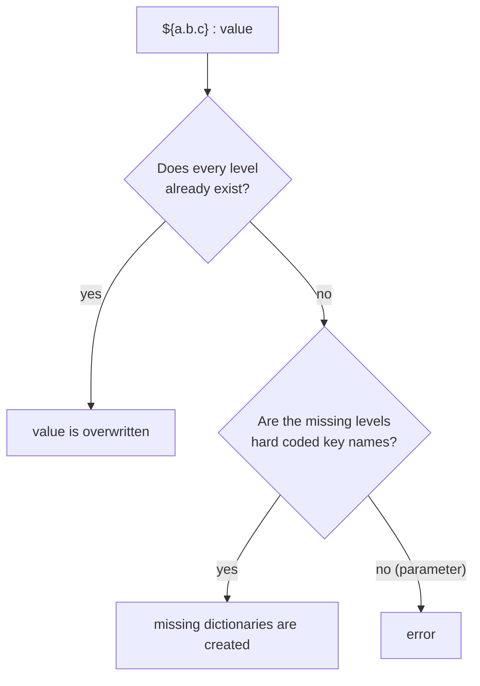

# Implicit creation of dictionaries

## From explicit to implicit

Up to now we have discussed two different ways of creating nested dictionaries.

The first one is "on the fly":

```json
{
   "project_values" : {"keyA" : "keyA value",
                       "keyB" : {"keyB1" : "keyB1 value",
                                 "keyB2" : {"keyB21" : "keyB21 value",
                                            "keyB22" : "keyB22 value"}}}
}
```

If the definition has to be split (e.g. into several files), we have to add keys - and also the initialization - line by line:

```json
{
   "project_values" : {},
   ${project_values}['keyA'] : "keyA value",
   ${project_values}['keyB'] : {},
   ${project_values}['keyB']['keyB1'] : "keyB1 value",
   ${project_values}['keyB']['keyB2'] : {},
   ${project_values}['keyB']['keyB2']['keyB21'] : "keyB21 value",
   ${project_values}['keyB']['keyB2']['keyB22'] : "keyB22 value"
}
```

The result is the same as in the previous example. But this way is long-winded, because every initialization of a
dictionary requires a separate line of code (at every level).

To shorten the code, the JsonPreprocessor supports the **implicit creation** of dictionaries. Missing levels are created automatically:

=== "Standard notation"

    ```json
    {
       ${project_values}['keyA'] : "keyA value",
       ${project_values}['keyB']['keyB1'] : "keyB1 value",
       ${project_values}['keyB']['keyB2']['keyB21'] : "keyB21 value",
       ${project_values}['keyB']['keyB2']['keyB22'] : "keyB22 value"
    }
    ```

=== "dotdict notation"

    ```json
    {
       ${project_values.keyA} : "keyA value",
       ${project_values.keyB.keyB1} : "keyB1 value",
       ${project_values.keyB.keyB2.keyB21} : "keyB21 value",
       ${project_values.keyB.keyB2.keyB22} : "keyB22 value"
    }
    ```

    (Precondition: no key name contains a dot.)

!!! danger "Caution"
    - Do **not** mix both notations in one line of code. If lists and numerical indices are involved, prefer the standard notation.
    - In case of a missing level in between - like in `${project_values.keyB.keyB2.keyB22} : "keyB22 value"` - you will
      **not** get an error message! The entire data structure is created implicitly. This makes the mechanism very
      susceptible to **typing mistakes**.
    - The implicit creation does **not** work with **lists**. A list index out of range causes an error.

## Key names are hard coded

The implicit creation of data structures is only possible with **hard coded** key names. Parameters are not supported.

```json
{
   "paramA" : "ABC",
   "subKey" : "ABC",
   ${testdict.subKey.subKey.paramA} : "DEF"
}
```

All sub key levels within the expression `${testdict.subKey.subKey.paramA}` are interpreted as hard coded strings,
even if parameters with the same name exist. The name of the implicitly created key at bottom level is `"paramA"` -
and not the value `"ABC"` of the parameter with the same name.

**Outcome:**

```python
{'paramA': 'ABC', 'subKey': 'ABC', 'testdict': {'subKey': {'subKey': {'paramA': 'DEF'}}}}
```

## Parameters may refer to existing keys

It is possible to use parameters to refer to **already existing** keys:

```json
{
   // <data structure created implicitly>
   ${testdict.subKey_1.subKey_2.subKey_3} : "ABC",

   // <string parameter with name of an existing key>
   "keyName_3" : "subKey_3",

   // <parameter used to refer to an existing key>
   ${testdict.subKey_1.subKey_2.${keyName_3}} : "XYZ"
}
```

**Outcome:**

```python
{'keyName_3': 'subKey_3',
 'testdict': {'subKey_1': {'subKey_2': {'subKey_3': 'XYZ'}}}}
```

## Parameters cannot create new keys

```json
{
   // <data structure created implicitly>
   ${testdict.subKey_1.subKey_2.subKey_3} : "ABC",

   // <string parameter with name of a not existing key>
   "keyName_4" : "subKey_4",

   // <usage of keyName_4 is not possible here>
   ${testdict.subKey_1.subKey_2.${keyName_4}} : "XYZ"
}
```

**Outcome is the following error:**

```text
Identified dynamic name of key '${testdict.subKey_1.subKey_2.${keyName_4}}' that does not exist.
But new keys can only be created based on hard code names.
```

The same error happens with the standard notation:

```json
${testdict}['subKey_1']['subKey_2'][${keyName_4}] : "XYZ"
```

## Summary


