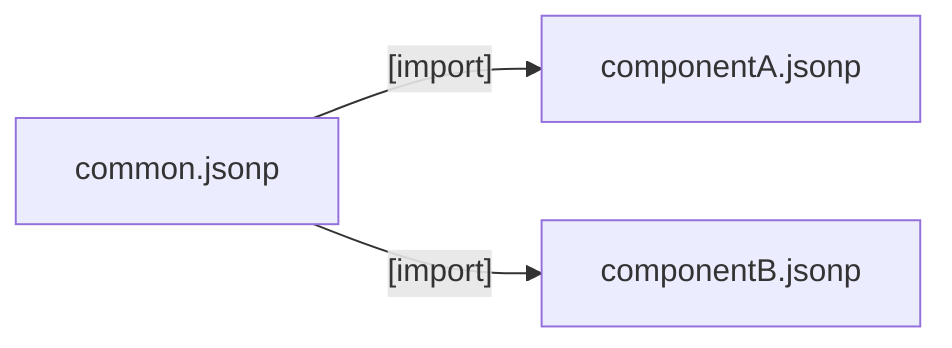
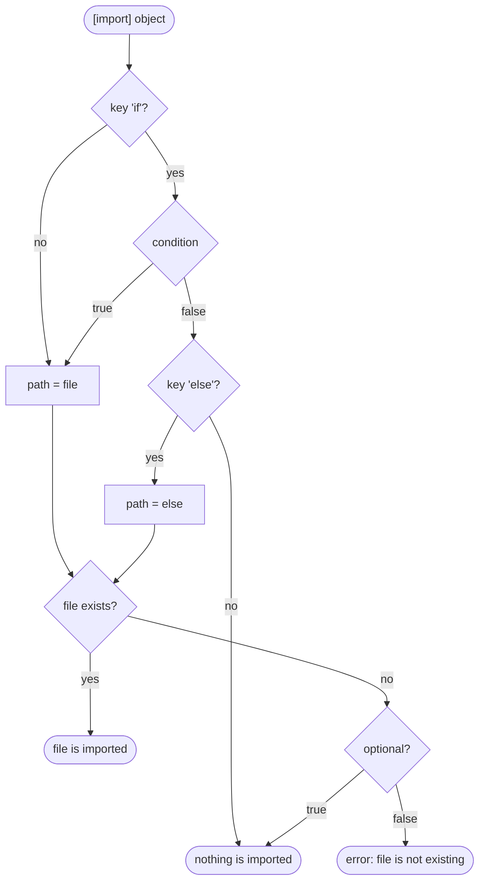

# Import of JSON files

## The scenario

A software component *A* requires a set of configuration parameters. A software component *B*, that belongs to the same
project, requires another set of configuration parameters. Additionally both components require a **common** set of
parameters (with the same values).

Without imports, both JSON files would contain the common set of parameters. This is unfavorable, because the
corresponding values need to be maintained at two different positions.

Therefore we use three files:

1. `common.jsonp` containing all parameters that are the same for component *A* and component *B*
2. `componentA.jsonp` containing the remaining parameters required for component *A*
3. `componentB.jsonp` containing the remaining parameters required for component *B*



## The import key

=== "common.jsonp"

    ```json
    {
       // common parameters
       "common_param_1" : "common value 1",
       "common_param_2" : "common value 2"
    }
    ```

=== "componentA.jsonp"

    ```json hl_lines="3"
    {
       // common parameters
       "[import]" : "./common.jsonp",
       //
       // component A parameters
       "componentA_param_1" : "componentA value 1",
       "componentA_param_2" : "componentA value 2"
    }
    ```

=== "componentB.jsonp"

    ```json hl_lines="3"
    {
       // common parameters
       "[import]" : "./common.jsonp",
       //
       // component B parameters
       "componentB_param_1" : "componentB value 1",
       "componentB_param_2" : "componentB value 2"
    }
    ```

JSON files are imported with the key **`"[import]"`**. The value of this key is the path and name of the JSON file to be imported.

- A relative path is relative to the location of the **importing** file.
- A JSON file can contain **more than one** import.
- Imports can be **nested**: an imported JSON file can import further JSON files.

**Outcome** of `componentA.jsonp`:

```python
{'common_param_1': 'common value 1',
 'common_param_2': 'common value 2',
 'componentA_param_1': 'componentA value 1',
 'componentA_param_2': 'componentA value 2'}
```

**Outcome** of `componentB.jsonp`:

```python
{'common_param_1': 'common value 1',
 'common_param_2': 'common value 2',
 'componentB_param_1': 'componentB value 1',
 'componentB_param_2': 'componentB value 2'}
```

The returned dictionary contains both the parameters from the loaded JSON file and the parameters imported by the loaded JSON file.

!!! info "How an import works"
    You can imagine an import as follows: the `"[import]"` line is **replaced by the content** (the key-value pairs)
    of the imported file - at exactly this position. This is the reason why the position of an import matters, see
    [Overwriting parameters](overwriting-parameters.md#the-order-matters).

## Multiple imports of the same file

A JSONP file can be imported more than once anywhere in the set of JSONP configuration files.
This mechanism can be used to define a common part for **different subkeys**.

=== "common_config/common.jsonp"

    ```json
    {
       // common parameters
       "common_param_1" : "common value 1",
       "common_param_2" : "common value 2"
    }
    ```

=== "componentA.jsonp"

    ```json hl_lines="6 12"
    {
       // component A parameters
       "componentA_param_1" : {
                                 "componentA_param_1_a" : "componentA_param_1_a value",
                                 // common parameters within componentA_param_1
                                 "[import]"             : "./common_config/common.jsonp",
                                 "componentA_param_1_b" : "componentA_param_1_b value"
                              },
       "componentA_param_2" : {
                                 "componentA_param_2_a" : "componentA_param_2_a value",
                                 // common parameters within componentA_param_2
                                 "[import]"             : "./common_config/common.jsonp",
                                 "componentA_param_2_b" : "componentA_param_2_b value"
                              }
    }
    ```

**Outcome:** The content of `common.jsonp` is part of `componentA_param_1` and also part of `componentA_param_2`.

```python
{'componentA_param_1': {'common_param_1': 'common value 1',
                        'common_param_2': 'common value 2',
                        'componentA_param_1_a': 'componentA_param_1_a value',
                        'componentA_param_1_b': 'componentA_param_1_b value'},
 'componentA_param_2': {'common_param_1': 'common value 1',
                        'common_param_2': 'common value 2',
                        'componentA_param_2_a': 'componentA_param_2_a value',
                        'componentA_param_2_b': 'componentA_param_2_b value'}}
```

## Dynamic import paths

The values of `"[import]"` keys must be of type `str`. Therefore it is possible to use dollar operator expressions
inside import paths.

An alternative version of the file `componentA.jsonp` from the example above:

```json hl_lines="2 7 13"
{
   "common_config_dir"  : "./common_config",
   // component A parameters
   "componentA_param_1" : {
                             "componentA_param_1_a" : "componentA_param_1_a value",
                             // common parameters within componentA_param_1
                             "[import]"             : "${common_config_dir}/common.jsonp",
                             "componentA_param_1_b" : "componentA_param_1_b value"
                          },
   "componentA_param_2" : {
                             "componentA_param_2_a" : "componentA_param_2_a value",
                             // common parameters within componentA_param_2
                             "[import]"             : "${common_config_dir}/common.jsonp",
                             "componentA_param_2_b" : "componentA_param_2_b value"
                          }
}
```

The outcome is the same as in the previous example.

!!! tip
    The import path can also be computed with [Python inline code](python-inline-code.md#further-examples), e.g.
    to select a file depending on a condition. For conditions the [import object](#conditional-imports) is the
    better readable alternative.

## Optional imports

The key **`"[import?]"`** imports a JSON file **only if the file exists**. A not existing file is silently ignored.

```json hl_lines="4"
{
   "[import]"  : "./common.jsonp",
   // local settings of a developer; not part of the repository
   "[import?]" : "./local_overrides.jsonp"
}
```

- The value must be of type `str`. Dollar operator expressions are allowed, like in `"[import]"`.
- Only the **existence** of the file is optional. An existing file with a syntax error, a not available parameter
  inside the path and a cyclic import are still errors.
- Optional imports are possible in all levels, also within imported files and sub-objects. `optional` is **not
  inherited**: a normal `"[import]"` of a not existing file inside an optionally imported file is still an error.
- `"[import?]"` is a short form of an [import object](#conditional-imports) with `"optional" : true`.

## Conditional imports

Instead of a path, the value of an `"[import]"` key can be an **import object** with the following keys:

| Key | Required | Value |
|---|---|---|
| `file` | yes | path of the file to import (`str`, dollar operator expressions allowed) |
| `if` | no | condition (`bool`): the file is imported only if the condition is `true` |
| `else` | no (requires `if`) | path of the file to import if the condition is `false` |
| `optional` | no | literal `true` or `false` (default): a not existing file (`file` or `else`) is ignored |

```json hl_lines="4-8"
{
   "target"    : "bench1",
   "use_debug" : true,
   "[import]"  : {
                    "file" : "./debug.jsonp",
                    "if"   : ${use_debug},
                    "else" : "./release.jsonp"
                 },
   "[import]"  : {
                    "file"     : "./benches/${target}.jsonp",
                    "if"       : <<${target} in ["bench1", "bench2"]>>,
                    "optional" : true
                 }
}
```

The condition can be:

- a boolean literal: `true`, `false`, `True`, `False`,
- a parameter of type `bool`: `${use_debug}`, `${config.debug}`, `${config}['debug']`,
- [Python inline code](python-inline-code.md) that returns a `bool`: `<<${hw_revision} >= 3>>`.



!!! note
    The condition is evaluated like any other value. It is recommended to define the parameters used in a
    condition **before** the import. Imported values overwrite previously defined values with the same name, like
    in a normal import.

!!! warning "Strings in inline code"
    Use `<<${target} == "bench1">>`, not `<<"${target}" == "bench1">>`. The dollar operator expression already
    provides a string value. See [Python inline code](python-inline-code.md).

## Rules and restrictions

| Rule | Details |
|---|---|
| Content of an imported file | must be a JSON **object** (`{ ... }`) |
| Not existing file | causes an error `File '...' is not existing!` (except with `"[import?]"` or `"optional" : true`) |
| Cyclic imports | are detected and cause an error (`Cyclic import detection: ...`) |
| Environment variables | are allowed in import paths in the notation of the operating system, e.g. `%CONFIG_DIR%/common.jsonp` on Windows |
| Value of `"[import?]"` | must be of type `str`; an import object is not allowed (use `"optional" : true` instead) |
| Keys of an import object | only `file`, `if`, `else` and `optional` are allowed, each key only once |
| Value of `if` | must be of type `bool` (`true`, `false`, parameter or inline code); `"true"` (string) is an error |
| Value of `optional` | must be the literal `true` or `false`; parameters are not allowed |
