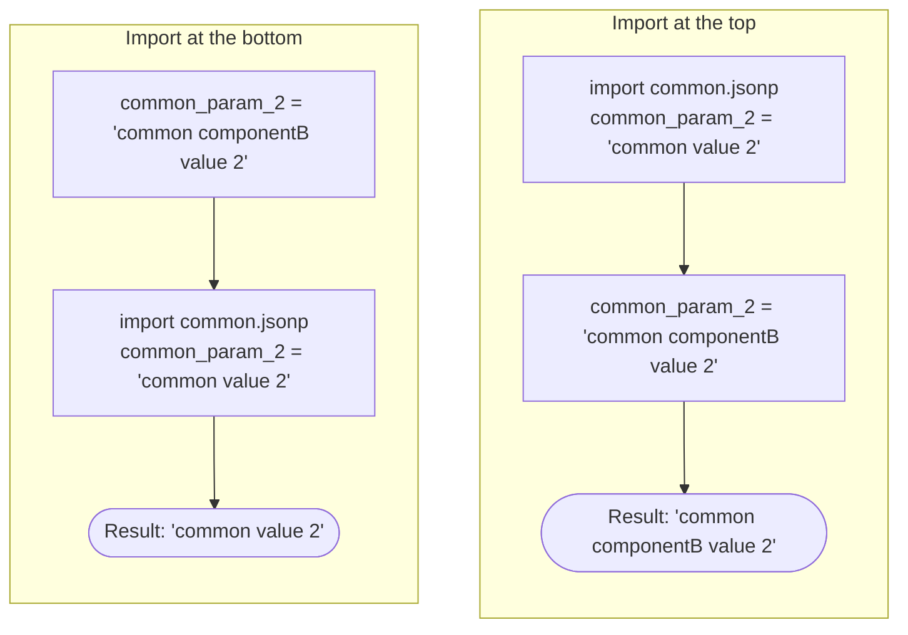
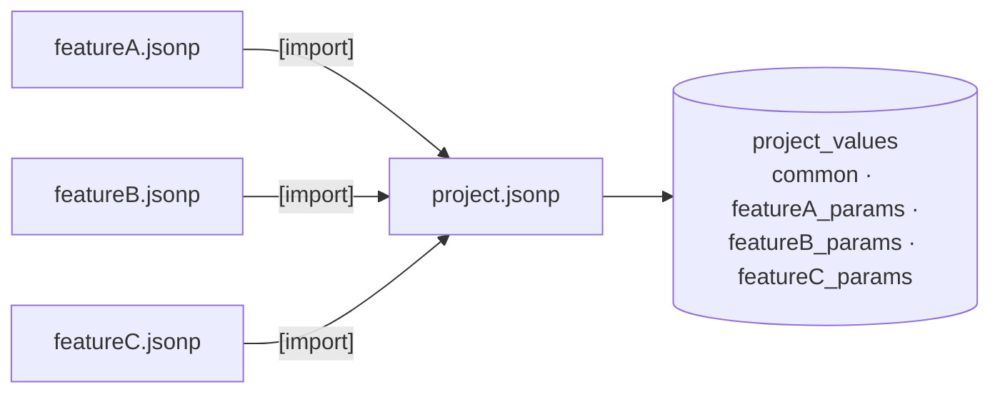

# Overwriting parameters

This section is the heart of the JSONP format. It answers the following questions:

1. How to change a value that was defined in an imported file?
2. How to get the value of an already existing parameter?
3. How to get the value of a single element of a list or a dictionary?
4. How to overwrite the value of a single element of a list or a dictionary?
5. How to add an element to a dictionary?

## Overwrite a value defined in an imported file

We take over the scenario from section [Import of JSON files](imports.md). But now component *B* requires a
**different value** of a common parameter.

=== "common.jsonp"

    ```json
    {
       // common parameters
       "common_param_1" : "common value 1",
       "common_param_2" : "common value 2"
    }
    ```

=== "componentB.jsonp"

    ```json hl_lines="8 9"
    {
       // common parameters
       "[import]" : "./common.jsonp",
       //
       // component B parameters
       "componentB_param_1" : "componentB value 1",
       "componentB_param_2" : "componentB value 2",
       // overwrite parameter initialized by imported file
       "common_param_2" : "common componentB value 2"
    }
    ```

With `"common_param_2" : "common componentB value 2"` in `componentB.jsonp`, the initial definition
`"common_param_2" : "common value 2"` in `common.jsonp` is overwritten.

**Outcome:**

```python
{'common_param_1': 'common value 1',
 'common_param_2': 'common componentB value 2',
 'componentB_param_1': 'componentB value 1',
 'componentB_param_2': 'componentB value 2'}
```

## The order matters

!!! warning "Important"
    The value a parameter has finally, depends on the **order** of definitions, redefinitions and imports!

In file `componentB.jsonp` we move the import of `common.jsonp` to the bottom:

```json hl_lines="8"
{
   // component B parameters
   "componentB_param_1" : "componentB value 1",
   "componentB_param_2" : "componentB value 2",
   "common_param_2"     : "common componentB value 2",
   //
   // common parameters
   "[import]" : "./common.jsonp"
}
```

Now the imported file overwrites the value initialized in the importing file.

**Outcome:**

```python
{'common_param_1': 'common value 1',
 'common_param_2': 'common value 2',
 'componentB_param_1': 'componentB value 1',
 'componentB_param_2': 'componentB value 2'}
```



**Rule of thumb:** the definition that is processed *last* wins - like in a program that assigns a variable several times.

## Access existing parameters

Up to now we considered simple data types only. In the following examples all values are part of composite data types
like lists and dictionaries:

=== "common.jsonp"

    ```json
    {
       // common parameters
       "common_param_1" : ["common value 1.1", "common value 1.2"],
       "common_param_2" : {"common_key_2_1" : "common value 2.1" ,
                           "common_key_2_2" : "common value 2.2"}
    }
    ```

=== "componentB.jsonp"

    ```json
    {
       // common parameters
       "[import]" : "./common.jsonp",
       //
       // component B parameters
       "componentB_param_1" : ["componentB value 1.1", "componentB value 1.2"],
       "componentB_param_2" : {"componentB_key_2_1" : "componentB value 2.1" ,
                               "componentB_key_2_2" : "componentB value 2.2"}
    }
    ```

We introduce a new file `componentB.2.jsonp` that imports `componentB.jsonp` and creates new parameters based on
already existing parameters:

```json
{
   // import of componentB parameters
   "[import]" : "./componentB.jsonp",
   //
   // some additional parameters of simple data type
   "string_val" : "ABC",
   "int_val"    : 123,
   "float_val"  : 4.56,
   "bool_val"   : true,
   "null_val"   : null,

   // access to existing parameters
   "string_val_b"         : ${string_val},
   "int_val_b"            : ${int_val},
   "float_val_b"          : ${float_val},
   "bool_val_b"           : ${bool_val},
   "null_val_b"           : ${null_val},
   "common_param_1_b"     : ${common_param_1},
   "componentB_param_2_b" : ${componentB_param_2}
}
```

**Outcome:**

```python
{'bool_val': True,
 'bool_val_b': True,
 'common_param_1': ['common value 1.1', 'common value 1.2'],
 'common_param_1_b': ['common value 1.1', 'common value 1.2'],
 'common_param_2': {'common_key_2_1': 'common value 2.1',
                    'common_key_2_2': 'common value 2.2'},
 'componentB_param_1': ['componentB value 1.1', 'componentB value 1.2'],
 'componentB_param_2': {'componentB_key_2_1': 'componentB value 2.1',
                        'componentB_key_2_2': 'componentB value 2.2'},
 'componentB_param_2_b': {'componentB_key_2_1': 'componentB value 2.1',
                          'componentB_key_2_2': 'componentB value 2.2'},
 'float_val': 4.56,
 'float_val_b': 4.56,
 'int_val': 123,
 'int_val_b': 123,
 'null_val': None,
 'null_val_b': None,
 'string_val': 'ABC',
 'string_val_b': 'ABC'}
```

!!! abstract "Rules for accessing parameters"
    - Existing parameters are accessed by a dollar operator and a pair of curly brackets (`${...}`) with the parameter name inside.
    - If the entire expression at the right-hand side of the colon is such a dollar operator expression, it is **not required**
      to encapsulate this expression in quotes (in opposite to what pure JSON would require).
    - **Without quotes**, the dollar operator keeps the data type of the referenced parameter.
      **With quotes**, the value is converted to type `str`. This implicit string conversion is limited to parameters of
      simple data types. Composite data types like lists and dictionaries cannot be used for that.

### With or without quotes

The dollar operator keeps the data type of the referenced parameter. If `int_val` is of type `int`, also `int_val_b` is of type `int`:

```json
"int_val_b" : ${int_val},
```

With quotes, the parameter `int_val_b` is of type `str`:

```json
"int_val_b" : "${int_val}",
```

### Composite strings

Further content can be added between the double quotes. This can be used to create composite strings:

```json
"str_val"   : "ABC",
"int_val"   : 1,
"float_val" : 2.3,
"bool_val"  : True,
"none_val"  : None,
"list_val"  : [1,2,3],
"dict_val"  : {"A" : "B"},
"newparam1" : "prefix_${str_val}_suffix",
"newparam2" : "prefix_${int_val}_suffix",
"newparam3" : "prefix_${float_val}_suffix",
"newparam4" : "prefix_${bool_val}_suffix",
"newparam5" : "prefix_${none_val}_suffix"
```

**Outcome:**

```python
{'bool_val': True,
 'dict_val': {'A': 'B'},
 'float_val': 2.3,
 'int_val': 1,
 'list_val': [1, 2, 3],
 'newparam1': 'prefix_ABC_suffix',
 'newparam2': 'prefix_1_suffix',
 'newparam3': 'prefix_2.3_suffix',
 'newparam4': 'prefix_True_suffix',
 'newparam5': 'prefix_None_suffix',
 'none_val': None,
 'str_val': 'ABC'}
```

Using composite data types inside strings is **not supported**:

```json
"newparam6" : "prefix_${list_val}_suffix",
"newparam7" : "prefix_${dict_val}_suffix"
```

**Result** for `"newparam6"`:

```text
The substitution of parameter '${list_val}' inside the string value 'prefix_${list_val}_suffix' is not allowed!
Composite data types like lists and dictionaries cannot be substituted inside strings.
```

## Access a single element

To access an element of a list and a key of a dictionary, we change the content of file `componentB.2.jsonp` to:

```json
{
   // import of componentB parameters
   "[import]" : "./componentB.jsonp",
   //
   "list_element_0" : ${componentB_param_1}[0],
   "dict_key_2_2"   : ${common_param_2}['common_key_2_2']
}
```

**Outcome:**

```python
{'common_param_1': ['common value 1.1', 'common value 1.2'],
 'common_param_2': {'common_key_2_1': 'common value 2.1',
                    'common_key_2_2': 'common value 2.2'},
 'componentB_param_1': ['componentB value 1.1', 'componentB value 1.2'],
 'componentB_param_2': {'componentB_key_2_1': 'componentB value 2.1',
                        'componentB_key_2_2': 'componentB value 2.2'},
 'dict_key_2_2': 'common value 2.2',
 'list_element_0': 'componentB value 1.1'}
```

## Overwrite a single element

In the next example we overwrite the value of a list element and the value of a dictionary key:

```json
{
   // import of componentB parameters
   "[import]" : "./componentB.jsonp",
   //
   ${componentB_param_1}[0]            : "componentB value 1.1 (new)",
   ${common_param_2}['common_key_2_1'] : "common value 2.1 (new)"
}
```

The dollar operator syntax at the left-hand side of the colon is the same as previously used on the right-hand side.

!!! warning
    The entire expression at the left-hand side of the colon must **not** be encapsulated in quotes.

**Outcome:** The single elements of the list and the dictionary are updated, all other elements are unchanged.

```python
{'common_param_1': ['common value 1.1', 'common value 1.2'],
 'common_param_2': {'common_key_2_1': 'common value 2.1 (new)',
                    'common_key_2_2': 'common value 2.2'},
 'componentB_param_1': ['componentB value 1.1 (new)', 'componentB value 1.2'],
 'componentB_param_2': {'componentB_key_2_1': 'componentB value 2.1',
                        'componentB_key_2_2': 'componentB value 2.2'}}
```

## Add an element

Adding further elements to an already existing **list** is not possible! But it is possible to add keys to an already
existing **dictionary**.

The following example extends the dictionary `common_param_2` by an additional key `common_key_2_3`:

```json
{
   // import of componentB parameters
   "[import]" : "./componentB.jsonp",
   //
   ${common_param_2}['common_key_2_3'] : "common value 2.3"
}
```

**Outcome:**

```python
{'common_param_1': ['common value 1.1', 'common value 1.2'],
 'common_param_2': {'common_key_2_1': 'common value 2.1',
                    'common_key_2_2': 'common value 2.2',
                    'common_key_2_3': 'common value 2.3'},
 'componentB_param_1': ['componentB value 1.1', 'componentB value 1.2'],
 'componentB_param_2': {'componentB_key_2_1': 'componentB value 2.1',
                        'componentB_key_2_2': 'componentB value 2.2'}}
```

!!! tip "Need a longer list?"
    Overwrite the entire list instead, e.g. with [Python inline code](python-inline-code.md):
    `${componentB_param_1} : <<${componentB_param_1} + ["new element"]>>`.

## Dictionary keys and indices as parameter

In all examples above the indices of lists and the key names of dictionaries are hard coded. It is also possible to use parameters.
The following example swaps the elements of a list and the values of a dictionary:

```json
{
   "index1"               : 0,
   "index2"               : 1,
   "key1"                 : "keyA",
   "key2"                 : "keyB",
   "testlist"             : ["A", "B"],
   "testdict"             : {"keyA" : "A", "keyB" : "B"},
   "tmp1"                 : ${testlist}[${index1}],
   "tmp2"                 : ${testdict}[${key1}],
   ${testlist}[${index1}] : ${testlist}[${index2}],
   ${testdict}[${key1}]   : ${testdict}[${key2}],
   ${testlist}[${index2}] : ${tmp1},
   ${testdict}[${key2}]   : ${tmp2}
}
```

**Outcome:**

```python
{'index1': 0,
 'index2': 1,
 'key1': 'keyA',
 'key2': 'keyB',
 'testdict': {'keyA': 'B', 'keyB': 'A'},
 'testlist': ['B', 'A'],
 'tmp1': 'A',
 'tmp2': 'A'}
```

## Meaning of single quotes in square brackets

Single quotes convert the content inside to a string.

- If the parameter `param` is of type `str`, the expressions `[${param}]` and `['${param}']` have the same outcome:
  the content inside the square brackets is a string.
- If the parameter `param` is of type `int`, the quotes in `['${param}']` convert the integer value to a string.
  Without the quotes (`[${param}]`), the content inside the square brackets is an integer.

Only strings and integers are expected inside square brackets. Dictionaries require a string (a key name),
lists require an integer (an index). Deviations cause an error.

Summarized, the following combinations are valid (on both sides of the colon):

| Expression | Container | Index / key |
|---|---|---|
| `${listparam}[${intparam}]` | list | integer parameter |
| `${listparam}[1]` | list | integer literal |
| `${dictparam}['${intparam}']` | dictionary | integer parameter converted to string |
| `${dictparam}[${stringparam}]` | dictionary | string parameter |
| `${dictparam}['${stringparam}']` | dictionary | string parameter |
| `${dictparam}['keyname']` | dictionary | string literal |

## Use of a common dictionary

The last example in this section covers the following use case:

- A project has several JSONP files, each for a certain purpose (e.g. one file per feature).
- They are all imported into a main JSONP file - the file that is handed over to the JsonPreprocessor.
- Every imported file introduces a bunch of parameters. All parameters shall be part of **one common dictionary**.



=== "project.jsonp"

    ```json
    {
       // define some common values
       ${project_values}['common_project_param_1'] : "common project value 1",
       ${project_values}['common_project_param_2'] : "common project value 2",
       //
       // import feature parameters
       "[import]" : "./featureA.jsonp",
       "[import]" : "./featureB.jsonp",
       "[import]" : "./featureC.jsonp"
    }
    ```

=== "featureA.jsonp"

    ```json
    {
       // parameters required for feature A
       ${project_values}['featureA_params']['featureA_param_1'] : "featureA param 1 value",
       ${project_values}['featureA_params']['featureA_param_2'] : "featureA param 2 value"
    }
    ```

=== "featureB.jsonp"

    ```json
    {
       // parameters required for feature B
       ${project_values}['featureB_params']['featureB_param_1'] : "featureB param 1 value",
       ${project_values}['featureB_params']['featureB_param_2'] : "featureB param 2 value"
    }
    ```

=== "featureC.jsonp"

    ```json
    {
       // parameters required for feature C
       ${project_values}['featureC_params']['featureC_param_1'] : "featureC param 1 value",
       ${project_values}['featureC_params']['featureC_param_2'] : "featureC param 2 value"
    }
    ```

It is not required to start with dictionary initializations like

```json
"project_values" : {},
${project_values}['featureA_params'] : {},
${project_values}['featureB_params'] : {},
${project_values}['featureC_params'] : {},
```

These initializations are done implicitly by the JsonPreprocessor, see
[Implicit creation of dictionaries](implicit-creation.md).

!!! warning
    It is still possible to initialize a dictionary explicitly with `{}`. But keep in mind:
    this **deletes all already existing keys** in this dictionary!

**Outcome:**

```python
{'project_values': {'common_project_param_1': 'common project value 1',
                    'common_project_param_2': 'common project value 2',
                    'featureA_params': {'featureA_param_1': 'featureA param 1 value',
                                        'featureA_param_2': 'featureA param 2 value'},
                    'featureB_params': {'featureB_param_1': 'featureB param 1 value',
                                        'featureB_param_2': 'featureB param 2 value'},
                    'featureC_params': {'featureC_param_1': 'featureC param 1 value',
                                        'featureC_param_2': 'featureC param 2 value'}}}
```
