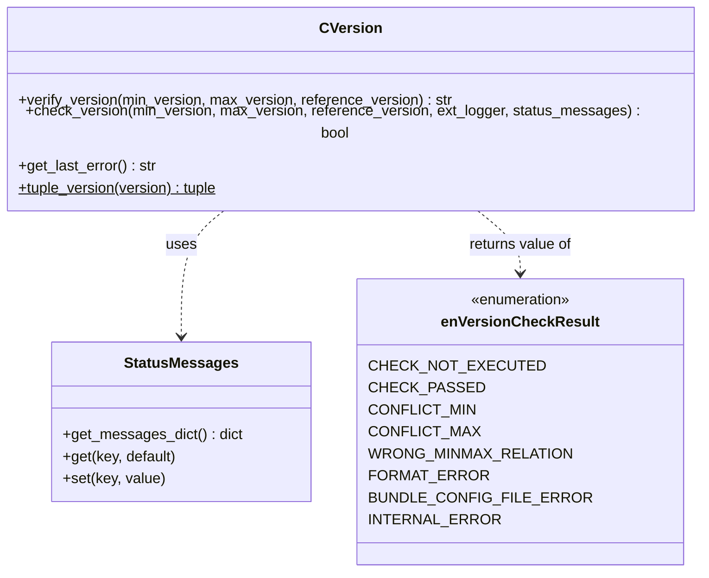

# Python API

The version control is also available for users who work purely in Python, without robot files.
All classes are located in the module `RobotFramework_TestsuitesManagement.Utils.version`.



## Two levels of control

| Method | Level | Logging | Exceptions | Use it if ... |
|---|---|---|---|---|
| `check_version` | high | yes | yes, if the check fails | you want the easy way |
| `verify_version` | low | no | no | you want full control over messages and reactions |

## Low level: `verify_version`

```python
from RobotFramework_TestsuitesManagement.Utils.version import CVersion, enVersionCheckResult

version = CVersion()
result = version.verify_version(min_version="0.6.0", max_version="1.99.0")

if result == enVersionCheckResult.CHECK_PASSED.value:
    print("Installation OK")
elif result in (enVersionCheckResult.CONFLICT_MIN.value, enVersionCheckResult.CONFLICT_MAX.value):
    print(f"Wrong version: {version.get_last_error()}")
else:
    print(f"Version check not possible: {result} - {version.get_last_error()}")
```

| Argument | Default | Description |
|---|---|---|
| `min_version` | `None` | lowest allowed version (string); `None`: not checked |
| `max_version` | `None` | highest allowed version (string); `None`: not checked |
| `reference_version` | `None` | version to check; `None` or `""`: version of the installed bundle |

**Returns** a single token string (the value of an `enVersionCheckResult`):

| Token | Meaning |
|---|---|
| `CHECK_NOT_EXECUTED` | both `min_version` and `max_version` are `None` |
| `CHECK_PASSED` | the reference version is within the range |
| `CONFLICT_MIN` | the reference version is older than the minimum version |
| `CONFLICT_MAX` | the reference version is younger than the maximum version |
| `WRONG_MINMAX_RELATION` | the minimum version is younger than the maximum version |
| `FORMAT_ERROR` | invalid version format (e.g. too many parts, not a string) |
| `BUNDLE_CONFIG_FILE_ERROR` | the RobotFramework AIO package context file cannot be read |
| `INTERNAL_ERROR` | internal error |

Because only a token is returned, you can formulate your own messages. Details about the failure are available with
`get_last_error()`.

!!! note "Changed interface"
    Older versions of this documentation described a tuple `(result, reason)` as return value and lower case tokens
    like `conflict_min`. The current implementation returns one upper case token as shown above.

## High level: `check_version`

```python
from RobotFramework_TestsuitesManagement.Utils.version import CVersion

CVersion().check_version(min_version="0.6.0", max_version="1.99.0")
```

| Argument | Default | Description |
|---|---|---|
| `min_version`, `max_version`, `reference_version` | `None` | like `verify_version` |
| `ext_logger` | `None` | own logger object with the methods `info` and `error`; default: internal Python logger |
| `status_messages` | `None` | `StatusMessages` object or dictionary with own message texts |

**Returns** `True` if the check passed or was skipped. Otherwise the error is logged and an exception is raised:

| Token | Exception message |
|---|---|
| `CONFLICT_MIN`, `CONFLICT_MAX` | `Execution will be aborted because of a failed version check` |
| `WRONG_MINMAX_RELATION`, `FORMAT_ERROR`, `INTERNAL_ERROR` | `Execution will be aborted because of a critical version check issue` |

## Own status messages

```python
from RobotFramework_TestsuitesManagement.Utils.version import CVersion, StatusMessages

messages = StatusMessages()
messages["CONFLICT_MAX"] = "Please use version <max_version> or older (installed: <reference_version>)"
CVersion().check_version(max_version="0.2.0", status_messages=messages)
```

Available placeholders: `<min_version>`, `<max_version>`, `<reference_version>`, `<invalid_format_reason>`.

## Helper: `tuple_version`

```python
>>> CVersion.tuple_version("1.2rc3")
((1, 3, 0), (2, 2, 3), (0, 3, 0))
```

Converts a version string into a comparable tuple. Missing parts are set to `0`, more than three parts are ignored.
Each part is a tuple `(number, tag, tag number)` with the tag order `a` (0) < `b` (1) < `rc` (2) < released (3).

## camelCase aliases

For compatibility, `verifyVersion` and `checkVersion` are available as aliases of `verify_version` and `check_version`.
