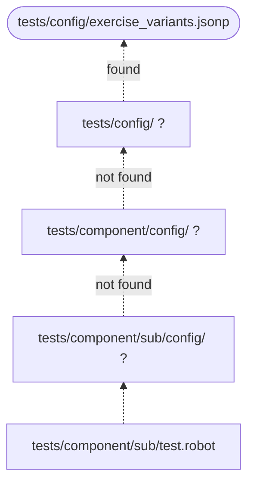

# Activation of Test Suites Management

## Import the library

```robotframework
*** Settings ***
Library    RobotFramework_TestsuitesManagement    AS    tm
```

We recommend the `AS` option to shorten the robot code a little bit.

## Call the suite setup

The configuration is loaded by the keyword `testsuite_setup` within the `Suite Setup`:

=== "Without variant handling"

    ```robotframework
    Suite Setup    tm.testsuite_setup
    ```

    The configuration is taken from command line (level 1), from a `config` folder (level 3) or from the
    default configuration of the installation (level 4).

=== "With variant handling (recommended)"

    ```robotframework
    Suite Setup    tm.testsuite_setup    .../config/exercise_variants.jsonp
    ```

    The parameter is the path to the **variant configuration file** (level 2).

The levels are explained in [Configuration levels](configuration-levels.md).

## The three dots

The path to the variant configuration file can be absolute or relative to the robot file. But a relative path
depends on the directory depth of the robot file - every robot file would need a different number of `../`.

The **three dots** `.../` tell the TestsuitesManagement to search upwards from the robot file location until the file is found:

```text
./config/exercise_variants.jsonp
../config/exercise_variants.jsonp
../../config/exercise_variants.jsonp
../../../config/exercise_variants.jsonp
...
```



!!! tip
    With the three dots notation you can move your test suites up or down in the file system without changing
    the position of the `config` folder and without changing the robot files.

## Optional: test setup and teardown

The library also provides keywords that write additional information to the log file:

```robotframework
*** Settings ***
Library           RobotFramework_TestsuitesManagement    AS    tm
Suite Setup       tm.testsuite_setup       .../config/exercise_variants.jsonp
Suite Teardown    tm.testsuite_teardown
Test Setup        tm.testcase_setup
Test Teardown     tm.testcase_teardown
```

See the [Keyword reference](../reference/keywords.md).

## Log output

The log file contains the selected level and the resulting parameter configuration file, for example:

```text
INFO - Running with configuration level 2 (variant name in command line)
INFO - Loaded configuration file '.../config/exercise_config.jsonp'
INFO - Suite Path: '.../tests/'
INFO - Number of test suites: 1
INFO - Total number of testcases: 3
```

!!! note
    `testsuite_setup` takes the **variant configuration file** (here: `exercise_variants.jsonp`), whereas the log
    contains the resulting **parameter configuration file** (here: `exercise_config.jsonp`), selected by the variant name.
