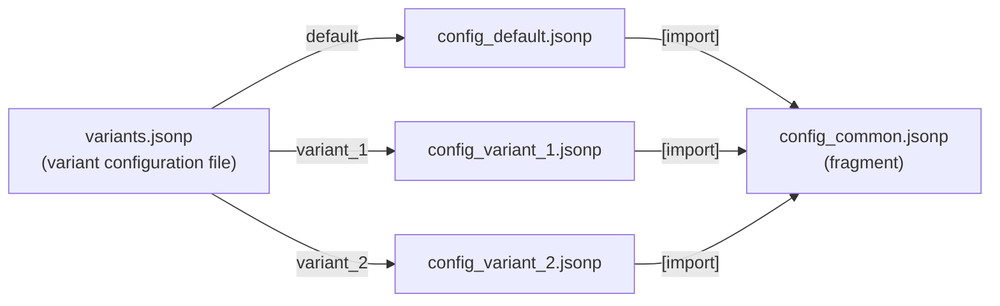

# Content of configuration files



## Variant configuration file

This file maps variant names to parameter configuration files:

```json
{
  "default": {
               "name": "robot_execution_config.jsonp",
               "path": "./config/"
             },
  "variant_1": {
                 "name": "robot_config_variant_1.jsonp",
                 "path": "./config/"
               },
  "variant_2": {
                 "name": "robot_config_variant_2.jsonp",
                 "path": "./config/"
               }
}
```

| Element | Meaning |
|---|---|
| top level key | name of the variant, used in command line: `--variable variant:variant_1` |
| `name` | name of the parameter configuration file (must not be empty) |
| `path` | path to the parameter configuration file - absolute or relative to the **variant configuration file** |

The variant **`default`** becomes active if no variant name is given in command line.

!!! note "Allowed variant names"
    Variant names may contain ASCII letters, digits, non-ASCII characters and the characters `.`, `_`, `-`, `:`, `@` and `$`.

## Parameter configuration files

These files contain all parameters that shall be available globally during the test execution.

### Mandatory parameters

The smallest version of a parameter configuration file (this is also the default configuration that is part of the installation):

```json
{
  "WelcomeString"   : "Hello... RobotFramework AIO is running now!",
  "Maximum_version" : "1.99.0",
  "Minimum_version" : "0.6.0",
  "Project"         : "RobotFramework Testsuites",
  "TargetName"      : "Device_01"
}
```

| Parameter | Required | Meaning |
|---|---|---|
| `Project` | yes | name of the project (also written to the suite metadata) |
| `WelcomeString` | yes | any string |
| `TargetName` | yes | name of the target (device under test) |
| `Maximum_version` | no | highest allowed version of the installation, or `null` |
| `Minimum_version` | no | lowest allowed version of the installation, or `null` |
| `params` | no | container for user defined parameters, see below |

`Maximum_version` and `Minimum_version` belong to the implicit [version control](version-control.md): if the version
of the installed software is outside this range, the test execution is aborted.
To disable the version control, set both to `null` or remove them. If only one of them is defined, only this limit is checked:

```json
"Maximum_version" : null,
"Minimum_version" : "0.6.0",
```

The top level parameters are keys of an internal configuration dictionary. They are accessed via `${CONFIG}`:

```robotframework
Log    Maximum_version: ${CONFIG}[Maximum_version]
Log    Project: ${CONFIG}[Project]
```

### User defined parameters

User defined parameters have to be placed inside `params` → `global`:

```json hl_lines="7-13"
{
  "WelcomeString"   : "Hello... Robot Framework is running now!",
  "Maximum_version" : "1.99.0",
  "Minimum_version" : "0.6.0",
  "Project"         : "RobotFramework Testsuites",
  "TargetName"      : "Device_01",
  "params": {
              // global parameters
              "global" : {
                           "param1" : "ABC",
                           "param2" : 25
                         }
            }
}
```

All parameters inside `params` → `global` become **global Robot Framework variables** and are accessed directly:

```robotframework
Log    param1: ${param1}
```

The intermediate level `global` is introduced to enable further parameter scopes in future.

!!! warning "Additional top level parameters are not allowed"
    The configuration is validated against a JSON schema. Any other top level key than the ones listed above
    causes the error:

    ```text
    Please put the additional params into 'params': { 'global': {...}
    ```

### Summary: how to access parameters

| Defined in | Access in robot file |
|---|---|
| top level, e.g. `"Project"` | `${CONFIG}[Project]` or `${CONFIG.Project}` |
| `params` → `global` → `"param1"` | `${param1}` |
| nested: `params` → `global` → `"server"` → `"port"` | `${server}[port]` or `${server.port}` |

!!! tip
    The keyword [`Get Config`](../reference/keywords.md#get-config) returns a copy of the complete configuration
    (including `params`).

## Why `.jsonp`?

All configuration files use an extended JSON format (comments, imports, references between parameters, ...).
To give editors and syntax checkers a chance to handle these deviations, the files have the extension `.jsonp`.
The extension `.json` is accepted, too. Details: [The JSONP format](../jsonp-format/index.md).
