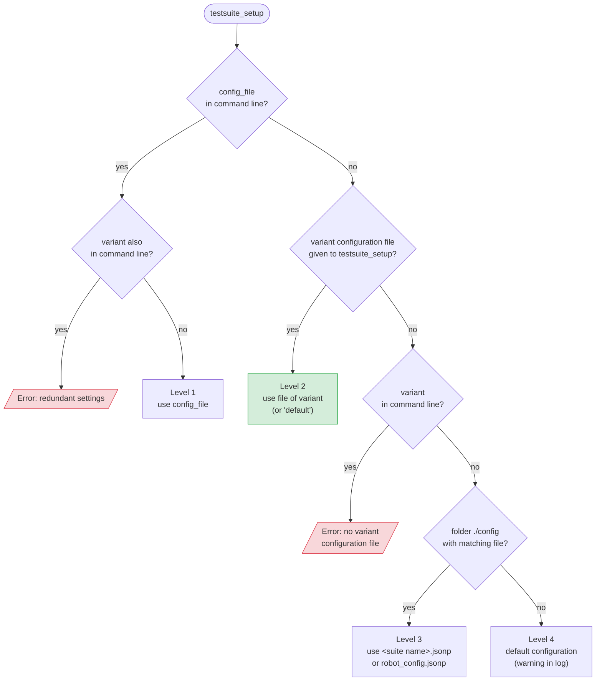

# Configuration levels

Every test execution with the TestsuitesManagement requires a configuration. There are four possibilities -
called **levels** - to provide it. The TestsuitesManagement checks them in a fixed order: level 1 has the highest
priority, level 4 the lowest. The first level that applies wins - all other levels are ignored.

| Level | Source of the parameter configuration file | Rating |
|---|---|---|
| **1** | path and name given in command line: `--variable config_file:"..."` | for special purposes |
| **2** | variant name given in command line (`--variable variant:"..."`) and variant configuration file given to `testsuite_setup`; without variant name the variant `default` is used | **recommended** |
| **3** | file in a folder `config` next to the test suite | possible |
| **4** | default configuration that is part of the installation | fallback only, unwanted |

## How the level is determined



## Summary

- A parameter configuration file in command line (level 1) is used - even if other configuration files are available.
- Otherwise, if a variant configuration file is passed to `testsuite_setup`, the configuration belonging to the
  variant name in command line (or to `default`) is used (level 2).
- Otherwise the TestsuitesManagement searches a `config` folder next to the test suite (level 3).
- If nothing is found, the default configuration from the installation folder is loaded (level 4) and a warning is logged.

## Traceability

The log file answers two important questions:

1. *Which parameter configuration file is used?* - the log contains path and name of the file.
2. *Why is this file used?* - the log contains the level number and its meaning.

```text
INFO - Running with configuration level 2 (variant name in command line)
INFO - Loaded configuration file 'C:/project/config/config_variant_2.jsonp'
```

With these entries the test execution is understandable and traceable - also for huge test suites.

## Why is level 2 recommended?

- **Level 1**: the selected values are only visible in the log files, not in the code, because the selection happens in command line only.
- **Level 2**: the robot files contain a link to the variant configuration file. To support another set of values,
  you only add another parameter configuration file and another entry in the variant configuration file -
  **without changing any test implementation**.
- **Level 3**: strong binding between robot files and configuration files. A later switch to variant handling (level 2)
  causes implementation effort.
- **Level 4**: contains only the default values of the installation - no project specific parameters.

!!! warning "Do not mix levels"
    We strongly recommend not to mix up several different configuration levels in one project!

## Levels and multiple test suites

When a folder with several robot files is executed, the level is determined again for every test suite
(except level 1, which is valid for the entire execution). So different suites can use different levels -
which is exactly the reason for the recommendation above.

How to select the variants in detail is described in [Variants selection](variants-selection.md).
