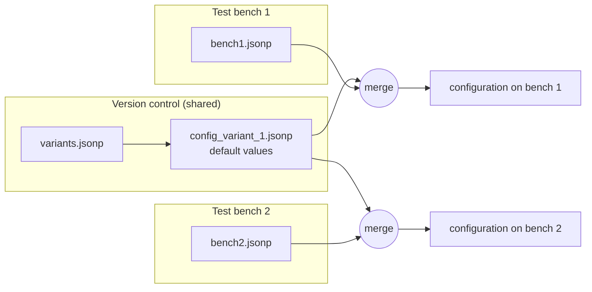

# Local configuration

Tests are often executed on several test benches, and every test bench has its own hardware. Some parameters
therefore need **test bench specific** values - either common parameters or parameters that are both variant
specific *and* test bench specific.

The **local configuration** provides such values. *Local* means: placed on a certain test bench - and valid for
this bench only.



The local configuration is loaded **after** the parameter configuration file and overwrites its values. So you can
define default values in the shared configuration and overwrite them with test bench specific values.

## Content of a local configuration file

A local configuration file is a **fragment** - not a full configuration. Nevertheless it has to follow the JSONP
syntax rules (at least it starts with `{` and ends with `}`).

Both notations are possible:

=== "Overwrite syntax"

    ```json
    {
       ${params}['global']['teststring_bench'] : "I am the 'bench1' configuration"
    }
    ```

=== "Nested structure"

    ```json
    {
       "params" : {
          "global" : {
             "teststring_bench" : "I am the 'bench1' configuration"
          }
       }
    }
    ```

!!! warning "Important"
    - A local configuration file must not contain the mandatory top level parameters (like `WelcomeString`).
      A local configuration containing `WelcomeString` - or a variant `default` (i.e. a variant configuration file) -
      is rejected with *"Wrong local config file was chosen, please check!!!"*.
    - The local configuration file is processed separately. It cannot reference (`${...}`) parameters of the
      parameter configuration file.

## Activation

The local configuration is optional. There are two ways to activate it:

=== "Command line"

    ```bash
    robot --variable local_config:"(path to local configuration file)" tests/
    ```

=== "Environment variable"

    Create an environment variable `ROBOT_LOCAL_CONFIG` containing path and name of the local configuration file.

    ```powershell
    # Windows (PowerShell, permanently for the current user)
    [Environment]::SetEnvironmentVariable("ROBOT_LOCAL_CONFIG", "C:\benches\bench1.jsonp", "User")
    ```

    ```bash
    # Linux
    export ROBOT_LOCAL_CONFIG=/opt/benches/bench1.jsonp
    ```

    With this mechanism every test bench automatically uses its own local configuration - without any
    command line extension. **The user has to create this environment variable.**

The command line has a higher priority than the environment variable. If both are available, the local
configuration is taken from command line. The used file is written to the log:

```text
INFO - Local config file: 'C:/benches/bench1.jsonp'
```

!!! tip "Recommendation"
    To avoid an accidental overwriting of local configuration files in version control systems, give these files
    test bench specific names.
