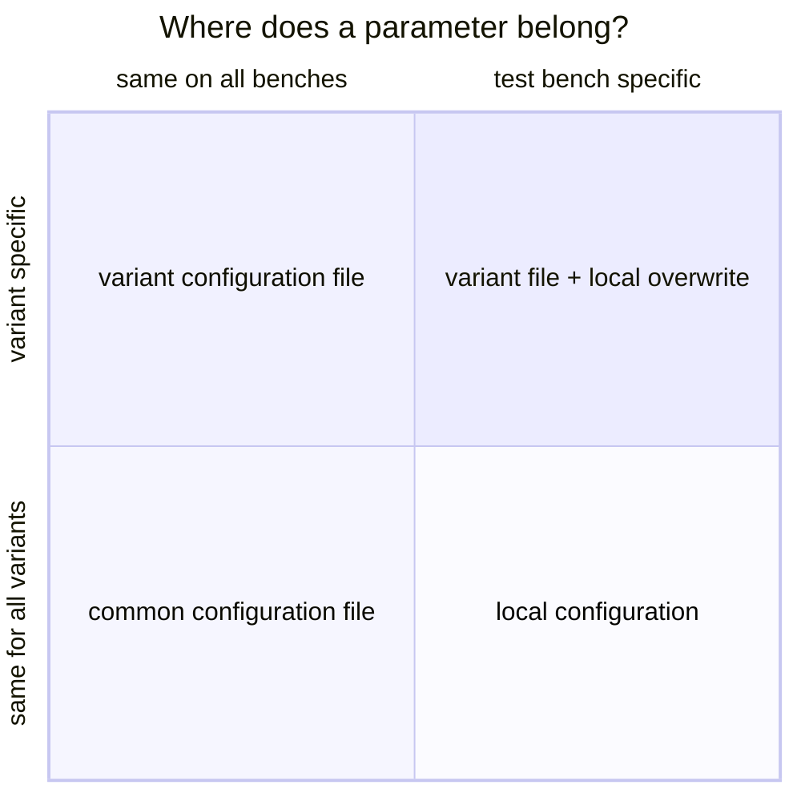

# Meaning of "Test Suites Management"

In Robot Framework a **test suite** is either a single robot file containing one or more test cases, or a folder
with several robot files.

## Same tests - different conditions

Usually all test cases of a test suite run under the same conditions - but these conditions may differ:

- The same test is used to test several **variants** of a system under test.
- The tests are executed on several **test benches** with individual hardware.

We postulate: **When switching between variants and test benches, no changes shall be required within the test code.**

Therefore the variant and test bench specific values are stored in separate configuration files, and the
TestsuitesManagement makes either the one or the other set of values available - depending on outer circumstances
like *"which variant?"* and *"which test bench?"*.

## Plan the configuration of your project

To realize a test suites management for your project, sort all parameters into four groups:

| Parameter is ... | Place it in ... |
|---|---|
| the same in all variants and on all test benches | a common configuration file, [imported](nested-configuration.md) by all variant files |
| variant specific | the parameter configuration file of the variant |
| test bench specific | the [local configuration](local-configuration.md) of the test bench |
| variant **and** test bench specific | default value in the variant file, overwritten by the local configuration |

After this:

1. For every variant create a parameter configuration file.
2. In the variant configuration file define a name for every variant together with the path to the corresponding
   parameter configuration file.

The content of these files is described in [Content of configuration files](configuration-files.md).
