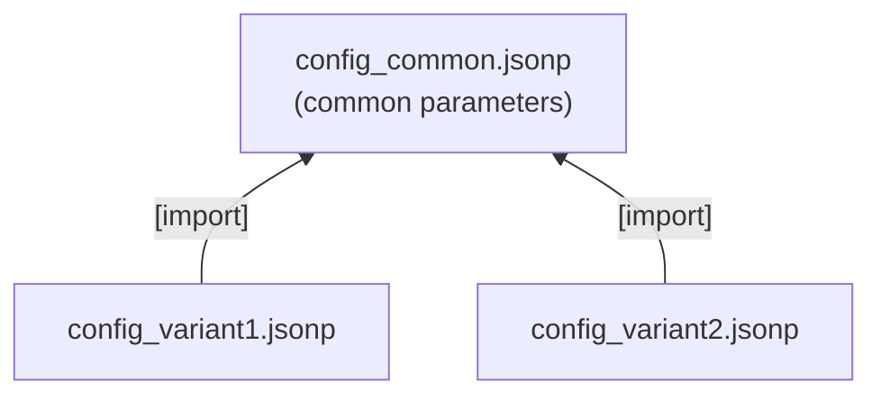

# Nested configuration files

When a project requires more and more parameters, it makes sense to split the configuration into smaller files.

Split all parameters into:

1. parameters that are specific for a certain variant,
2. common parameters that have the same value for all variants.

Placing the common parameters in every variant specific file would create redundancy and complicate the maintenance.
The solution: put the common parameters into a separate file and **import** it in every variant specific file.



## Example

Variant specific configuration files:

```text
config/config_variant1.jsonp
config/config_variant2.jsonp
```

Configuration file with common parameters:

```text
config/config_common.jsonp
```

Import of `config_common.jsonp` in `config_variant1.jsonp` and `config_variant2.jsonp`:

```json
"params" : {
            "global": {
                       "[import]"   : "./config_common.jsonp",
                       "teststring" : "variant specific value"
                      }
           }
```

The key `[import]` indicates the import of another configuration file. The value is the path and name of this file,
relative to the importing file.

## Rules

- Imports can be nested - an imported file may contain imports, too.
- The content of the importing file and of all imported files is merged. In case of duplicate parameter names,
  **later definitions overwrite earlier ones**. Therefore the position of the `[import]` key matters:

    ```json
    "global": {
                "[import]"   : "./config_common.jsonp",   // defines "teststring": "common value"
                "teststring" : "variant specific value"    // wins, because it comes later
              }
    ```

!!! warning "Important"
    - Imported configuration files are **fragments** - not a full configuration. Nevertheless they need to follow
      the JSONP syntax rules (at least an opening and a closing curly bracket).
    - Imported configuration files must not contain the mandatory top level parameters like `WelcomeString`.

All details about imports (dynamic paths, cyclic imports, ...) can be found in [Import of JSON files](../jsonp-format/imports.md).
