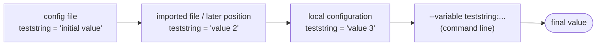

# Overwritten parameters

The TestsuitesManagement knows three types of parameter configuration files:

| Type | Content | Accessed by |
|---|---|---|
| full parameter configuration file | mandatory parameters and optionally user defined parameters | level 1 - 4 |
| imported fragment | user defined parameters | `[import]` key |
| local configuration (fragment) | user defined parameters | command line or environment variable |

All types can be used

1. to **define** new parameters,
2. to **overwrite** already existing parameters.

This applies to user defined parameters in `params` → `global`.

## Define a new parameter

```json
"params" : {
            "global": {
                       "teststring" : "initial value"
                      }
           }
```

## Overwrite an existing parameter

After the initial definition, a parameter can be overwritten at any later position

- in the same configuration file,
- in other configuration files like the imported ones,
- in a local configuration file,

with the following syntax:

```json
${params}['global']['teststring'] : "new value"
```

The same in [dotdict notation](../jsonp-format/dotdict-notation.md):

```json
${params.global.teststring} : "new value"
```

## Which value wins?



The resulting value depends on the order of processing described in
[Priority of configuration parameters](priority.md).

More examples (overwrite single elements of lists and dictionaries, add elements, ...) can be found in
[Overwriting parameters](../jsonp-format/overwriting-parameters.md).
