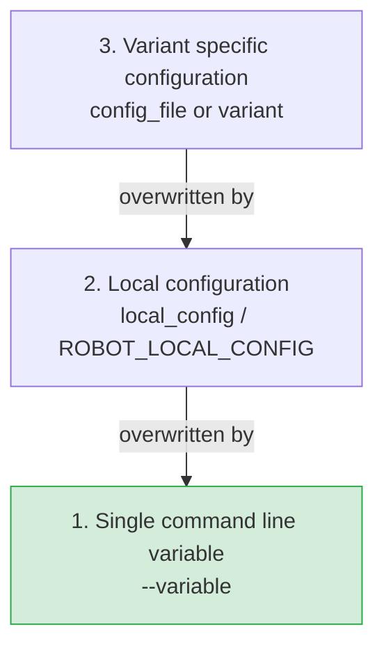

# Priority of configuration parameters

The [level concept](configuration-levels.md) defines **which** parameter configuration file is used. But further
rules influence the final value of a parameter:

- The local configuration has a higher priority than the parameter configuration.
- The command line has a higher priority than definitions within configuration files.

## Order of processing

In other words:

1. The variant specific configuration is overwritten by the local configuration.
2. The local configuration is overwritten by a single command line variable.

**Example:** the parameter `baudrate` is defined in all three places:

| Source | Value |
|---|---|
| `config_variant_1.jsonp` | `9600` |
| local configuration | `19200` |
| `--variable baudrate:115200` | `115200` |
| **Result `${baudrate}`** | **`115200`** |

!!! warning "Same spelling required"
    A command line variable only wins if its name is spelled **exactly** like the key in the configuration file.
    `--variable baudrate:1` overrules `"baudrate"`, but `--variable BAUDRATE:1` does not - the value from the
    configuration file is used.

## config_file and variant together?

`config_file` is level 1 and `variant` is level 2. This does **not** mean that `config_file` overwrites `variant`!
When a level is identified, all other levels are ignored - between levels there is an *either-or* relationship.
Therefore it makes no sense to define both in command line, and the TestsuitesManagement throws an error in this case.

## Robot Framework mechanisms

Robot Framework provides further possibilities to define variables in command line, e.g. `--variablefile`.

| Mechanism | Provided by |
|---|---|
| `--variable`, `--variablefile` | Robot Framework |
| `config_file`, `variant`, `local_config` | TestsuitesManagement |

The rules are:

- `--variable` overrules `--variablefile`.
- Robot Framework mechanisms overrule TestsuitesManagement mechanisms.

!!! tip "Recommendation"
    To keep things understandable, do not use both mechanisms to define *different values for the same parameters*.
    Overwriting a single variable with `--variable` (e.g. for a quick experiment) is fine.
