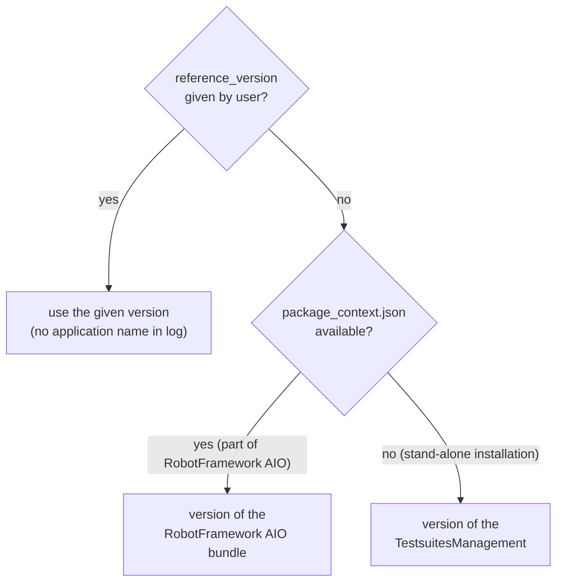

# Version control

The TestsuitesManagement supports a version control in two ways:

| Type | When | Configured by |
|---|---|---|
| **implicit** | automatically at the beginning of every test suite (during `testsuite_setup`) | `Minimum_version` / `Maximum_version` in the parameter configuration file |
| **explicit** | whenever the user calls it | keyword `check_version` (Robot Framework) or class `CVersion` (Python) |

## What is the reference version?

The versions are checked against a **reference version**. If no reference version is given explicitly, the
TestsuitesManagement decides itself which version is used:



The keywords [`Is Robotframework AIO`](../reference/keywords.md#is-robotframework-aio) and
[`Get Reference Version`](../reference/keywords.md#get-reference-version) show which case applies.

## Implicit version control

Defined in the parameter configuration file (see [Content of configuration files](configuration-files.md#mandatory-parameters)):

```json
"Maximum_version" : "1.99.0",
"Minimum_version" : "0.6.0",
```

If the reference version is outside this range, the test execution is aborted. Set a value to `null` (or remove it)
to skip this limit.

## Explicit version control in Robot Framework

### Check the installed software

```robotframework
*** Settings ***
Library    RobotFramework_TestsuitesManagement    AS    tm

*** Test Cases ***
Check installation
    ${result}=    tm.check_version    min_version=0.1.0    max_version=0.20.0
    Log    === check_version result: ${result}    console=yes
```

Without `reference_version` the version of the installed software is the reference. Assuming RobotFramework AIO
version 0.14.2.26 is installed:

```text
INFO - Version check passed (RobotFramework AIO (extended))
INFO - === check_version result: True
```

Exactly this already happened during `testsuite_setup` - so this check gives no new insights.

### Check the TestsuitesManagement

```robotframework
${tsm_version}=    tm.get_tsm_version
Log    === tsm_version: ${tsm_version}    console=yes
${result}=    tm.check_version    min_version=0.1.0    max_version=0.2.0    reference_version=${tsm_version}
```

If the TestsuitesManagement has version 0.9.0, the check fails:

```text
ERROR - Version check failed: The test execution requires the maximum version '0.2.0', but the reference version '0.9.0' is younger
UNKNOWN - Execution will be aborted because of a failed version check
```

Whether the test result is `UNKNOWN` or `FAIL` depends on the type of the RobotFramework AIO installation.
Details: [robotframework-aio.org](https://robotframework-aio.org/).

### User defined version checks

`check_version` can be used for any versions:

```robotframework
${result}=    tm.check_version    min_version=0.1.0    max_version=0.2.0    reference_version=1.2.3
```

Versions that are not relevant can be set to `${None}`. Here only the maximum version is checked:

```robotframework
${result}=    tm.check_version    min_version=${None}    max_version=0.2.0    reference_version=1.2.3
```

If both limits are `${None}` (or omitted), the check is skipped:

```robotframework
${result}=    tm.check_version    min_version=${None}    max_version=${None}
```

```text
INFO - Version check is skipped because both 'min_version' and 'max_version' are set to None (RobotFramework AIO (extended))
```

!!! info "Name of the reference application"
    If `reference_version` is **not** given, the name of the reference application is appended to the log message
    (here: `RobotFramework AIO (extended)`). If `reference_version` is given, no name is available and the log contains
    the message only.

## Version format

All version parameters accept the formats `major.minor.patch`, `major.minor` and `major`.
Each part may contain a pre-release tag: `a` (alpha) < `b` (beta) < `rc` (release candidate) < released, e.g. `1.2rc3` or `1.2.1b1`.

| Rule | Example |
|---|---|
| missing parts are filled with `0` | `2` is compared as `2.0.0` |
| min/max must not have more parts than the reference version | `0.2.0.9` against `1.2.3` → format error |
| only the first three parts are compared | `0.14.2.26` is compared as `0.14.2` |

```robotframework
${result}=    tm.check_version    min_version=0    max_version=2    reference_version=3
```

```text
ERROR - Version check failed: The test execution requires the maximum version '2', but the reference version '3' is younger
UNKNOWN - Execution will be aborted because of a failed version check
```

```robotframework
${result}=    tm.check_version    min_version=0.1.0    max_version=0.2.0.9    reference_version=1.2.3
```

```text
ERROR - Version format error: maximum version '0.2.0.9' contains too many parts (expected is a maximum of 3 parts)
UNKNOWN - Execution will be aborted because of a critical version check issue
```

## Results at a glance

| Result | Meaning | Reaction |
|---|---|---|
| `CHECK_PASSED` | reference version within the range | log info, return `True` |
| `CHECK_NOT_EXECUTED` | both limits are `None` | log info, return `True` |
| `CONFLICT_MIN` | reference version older than minimum | error, *failed version check* |
| `CONFLICT_MAX` | reference version younger than maximum | error, *failed version check* |
| `WRONG_MINMAX_RELATION` | minimum version younger than maximum version | error, *critical version check issue* |
| `FORMAT_ERROR` | invalid version format | error, *critical version check issue* |
| `BUNDLE_CONFIG_FILE_ERROR` | `package_context.json` cannot be read | error |
| `INTERNAL_ERROR` | internal error | error, *critical version check issue* |

## Own status messages

The log messages can be adapted. Get the default messages, change them and pass them to `check_version`:

```robotframework
*** Settings ***
Library    Collections
Library    RobotFramework_TestsuitesManagement    AS    tm

*** Test Cases ***
Check with own messages
    ${messages}=    tm.get_status_messages
    Set To Dictionary    ${messages}    CHECK_PASSED=Installation OK
    ${result}=    tm.check_version    min_version=0.1.0    max_version=9.0.0    status_messages=${messages}
```

```text
INFO - Installation OK (RobotFramework_TestsuitesManagement)
```

The placeholders `<min_version>`, `<max_version>`, `<reference_version>` and `<invalid_format_reason>` are replaced
by the current values.

## Python interface

Users who work purely in Python can use the class `CVersion` - see [Python API](../reference/python-api.md).
